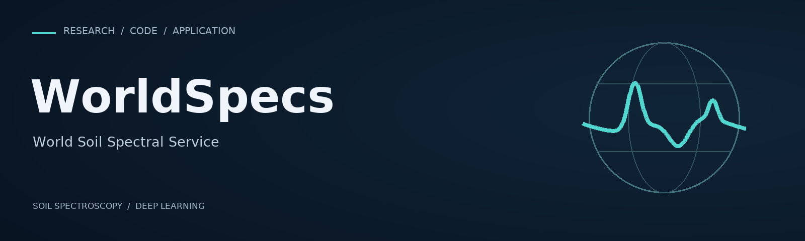

  

  <a href="https://worldspecs.soilslab.ai"><strong>Open the platform ↗</strong></a> &nbsp; · &nbsp;
  <a href="https://github.com/WorldSpecs/soil-mae">Explore Soil-MAE</a>

## Soil spectra. Shared scientific tools.

WorldSpecs brings together research software for global soil spectral modeling and the **World Soil Spectral Service**, a web platform for estimating soil properties from laboratory spectra.

### Explore the work

| Resource | Purpose | Availability |
| :--- | :--- | :--- |
| [WorldSpecs platform](https://worldspecs.soilslab.ai) | Estimate soil organic carbon, clay and sand from soil spectra. | Online service |
| [Soil-MAE](https://github.com/WorldSpecs/soil-mae) | Masked autoencoder architecture and training code for soil spectral modeling. | Code in preparation |

### Research and access

The accompanying manuscript is under review. Model architecture and training code are being prepared for release; trained weights and spectral data are not distributed. Predictions are available through the platform.

### A collaboration between

- [Geotechnologies in Soil Science group (GeoCiS)](https://geocis.esalq.usp.br/), Luiz de Queiroz College of Agriculture, University of São Paulo, Brazil.
- [Soil Science Artificial Intelligence Laboratory](https://soilslab.ai), University of Florida, USA · [GitHub](https://github.com/Soil-Science-AI-Lab).

### Leadership

| Name | Role in WorldSpecs | Position |
| :--- | :--- | :--- |
| [José Alexandre Demattê](https://esalq7.wixsite.com/jamdematte) | Project Director | Full Professor, University of São Paulo (ESALQ/USP); GeoCiS |
| [Nikolaos Tziolas](https://www.linkedin.com/in/nikostziolas/) | Technical Lead | Assistant Professor, University of Florida (UF/IFAS); Soil Science AI Lab |
